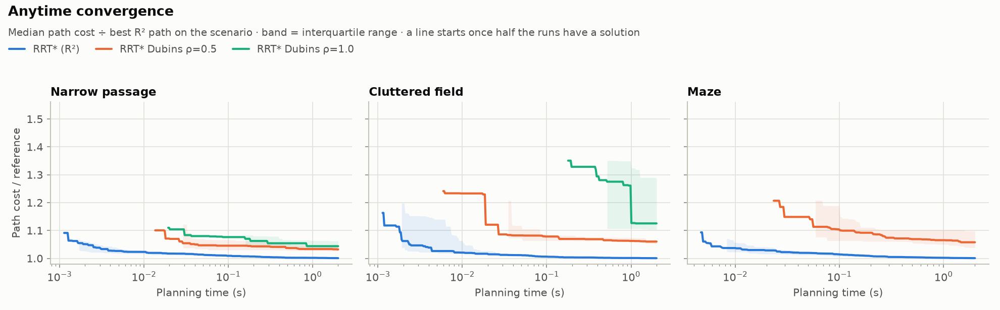
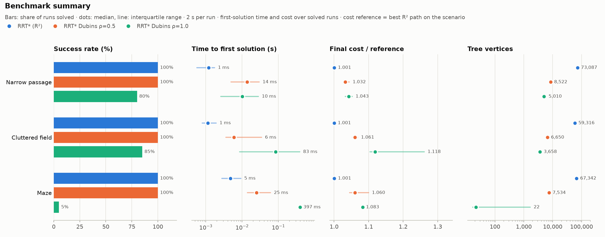
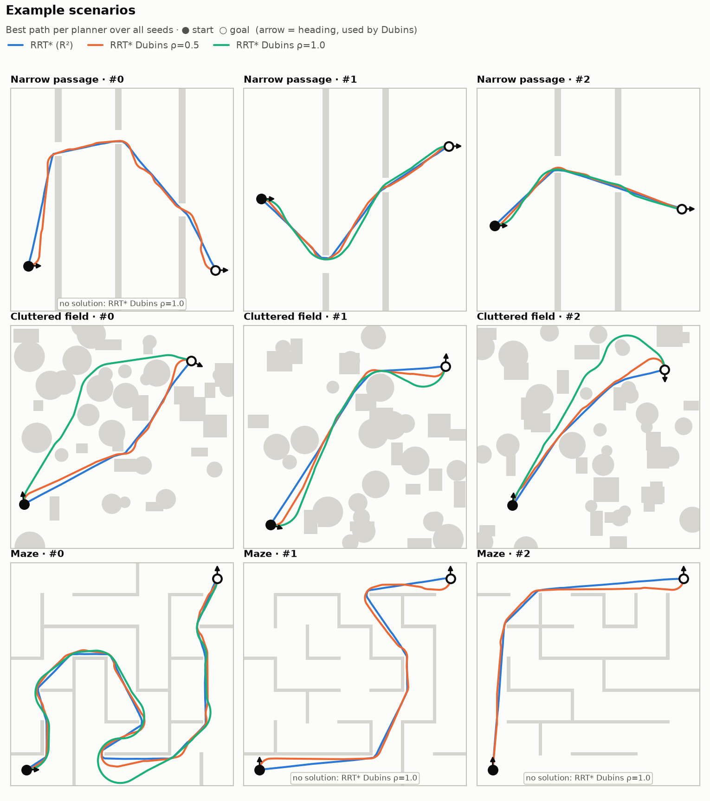

# rrt-planner

Sampling-based path planning in C++17:

- **RRT\*** in continuous 2D (holonomic point robot).
- **Kinodynamic RRT\*** for a car with a minimum turning radius. Every tree
  edge is an exact Dubins curve, so paths are curvature-bounded and
  heading-continuous.

Both use **the same planner class**. Only the `StateSpace` differs.

## Build

```sh
cmake -S . -B build -G Ninja
cmake --build build
ctest --test-dir build          # or ./build/rrt_tests
```

Dependencies: [nanoflann](https://github.com/jlblancoc/nanoflann) (KD-tree)
and GoogleTest (tests only). CMake uses installed copies when it finds them
and otherwise fetches them with `FetchContent`.

## Python

```sh
pip install .                       # builds the C++ core with scikit-build-core
python -c "import rrt_planner"
```

For development, build in-tree with CMake and point `PYTHONPATH` at
`python/`. That drops `_core.*.so` next to `python/rrt_planner/__init__.py`:

```sh
cmake -S . -B build -G Ninja -DRRT_BUILD_PYTHON=ON -DPython_EXECUTABLE=$(which python)
cmake --build build
PYTHONPATH=python python -m pytest
```

Requires pybind11 ≥ 3.0, because the bindings use `py::smart_holder`.

```python
import math, rrt_planner as rp

space = rp.DubinsStateSpace(0.6, 0, 10, 0, 10)
world = rp.GeometricWorld2D(0, 10, 0, 10, robot_radius=0.1)
world.add_box(4.5, 0.0, 5.5, 7.0)
problem = rp.PlanningProblem(space=space, checker=world, cost=rp.PathLengthCost(),
                             start=[1, 1, 0],
                             goal=rp.GoalState(space, [8, 2, math.pi / 2], 0.05))
planner = rp.RRTStar(rp.RRTStarConfig(max_step=1.0, max_rewire_radius=3.0))
planner.set_problem(problem)
res = planner.solve(time_limit=1.0)          # releases the GIL
res.dense_path(0.05)                         # N x 3 numpy array
res.convergence_array()                      # (time, iteration, tree_size, cost) rows
planner.tree_edges()                         # list of arrays, for plotting
```

**Python plug-ins.** `StateSpace`, `LocalPath`, `CollisionChecker`,
`CostFunction`, `Goal` and `Planner` can all be subclassed in Python and passed
to the C++ planner. See `tests/python/test_bindings.py` for a Python R² space,
checker, cost and goal driving `RRTStar`. Method names are snake_case
(`sample_uniform`, `embedding_dimension`, `is_state_valid`, `motion_cost`, ...).
`sample_uniform(rng)` and `Goal.sample(rng)` receive the planner's own `rng`
by reference, so use `rng.uniform(lo, hi)` and similar methods to keep runs
reproducible. `connect()` may return `None` when there is no feasible path.
Python plug-ins work, but every call re-acquires the GIL, so they are much
slower than C++ ones. Use them to prototype.

## Benchmark

```sh
pip install matplotlib
python -m bench.run                  # default suite, ~1 min on 16 threads
python -m bench.run --quick          # smoke test
python -m bench.run --families maze --instances 10 --runs 8 --time-limit 5 --jobs 4
python -m bench.plots bench_results/results.json   # re-plot without re-running
```

**Scenarios** (`bench/scenarios.py`) live in a 10 × 10 world with a disc robot
of radius 0.1. Each is seeded and deterministic, and is resampled until a grid
flood fill confirms it is solvable for a holonomic robot:

- **narrow_passage**: one to three full-height walls, each with a single gap
  0.45–0.8 wide.
- **cluttered**: random circles and boxes up to about 25% coverage, with a clear
  disc kept around the start and goal.
- **maze**: a 7 × 7 maze carved by randomised DFS, with 10% of the remaining walls
  removed to create loops.

Dubins feasibility is **not** guaranteed. A low Dubins success rate can mean
the car physically can't make the turns, not that the planner failed. A 1.0
turning radius can't turn around inside a 1.43 m maze cell.

**Planners** are listed in `bench/planners.py`: R² RRT\* and Dubins RRT\* with
ρ = 0.5 and 1.0. Adding a configuration takes one line.

**Outputs** go to `bench_results/`:

| file | contents |
|---|---|
| `results.json` | every run: success, cost, first-solution time and iteration, tree size, full convergence history, best path |
| `summary.md` / `summary.csv` | per (family, planner): success rate, median first-solution time, median cost ratio, median tree size, iterations/s |
| `success_vs_time.png` | share of runs solved by time t |
| `convergence.png` | anytime curve: median cost ÷ reference vs time, IQR band |
| `tree_growth.png` | median tree size vs time |
| `summary.png` | success rate, time to first solution, final cost ratio, tree size |
| `scenarios.png` | example instances with each planner's best path |

Costs are normalised by the **best R² path found on the same scenario**. A
Dubins path is also a valid R² path, so this is close to a lower bound, and the
ratio shows both how far a run has converged and what the turning-radius
constraint costs. The convergence history is recorded inside the planner
(`PlannerResult::convergence`): one sample at every cost improvement, plus one
every `--progress-interval` iterations for tree size. Timing therefore doesn't
include any Python overhead.

Runs execute in a thread pool. `solve()` releases the GIL, so threads run
truly in parallel. More `--jobs` finishes the suite faster but makes timings
noisier. The harness pins numpy's OpenBLAS pool to one thread, because its
spin-waiting otherwise takes about a quarter of the CPU.

### Sample results

Default suite: 5 scenarios × 4 seeds × 2 s per family and planner, 8 jobs on a
16-thread machine.





See [`docs/benchmark/summary.md`](docs/benchmark/summary.md) for the numbers.

## Examples

```sh
./build/plan_r2     [iterations] [out.svg]
./build/plan_dubins [iterations] [turning_radius] [out.svg]
```

Each example writes an SVG showing the obstacles, the search tree and the
solution.

## Architecture

```
include/rrt/
  core/         abstract interfaces + planner-facing types
    state_space.hpp        StateSpace        sample / distance / steer / embed
    local_path.hpp         LocalPath         an edge, parameterised by arc length
    collision_checker.hpp  CollisionChecker  isStateValid / isMotionValid
    cost_function.hpp      CostFunction      motionCost / combine (+ PathLengthCost)
    goal.hpp               Goal              isSatisfied / sample (+ GoalState)
    planner.hpp            Planner, PlanningProblem, Termination, PlannerResult
    nearest_neighbors.hpp  NearestNeighbors (KD-tree via nanoflann, brute force)
    instrumentation.hpp    CountingStateSpace / CountingCollisionChecker (call counters)
  spaces/       RealVector2DSpace, DubinsStateSpace, dubins:: closed-form solver
  collision/    GeometricWorld2D (circles/boxes, disc robot), OccupancyGrid + GridCollisionChecker
  cost/         CostmapCost (∫ 1 + w·c(x,y) ds over a grid)
  planners/     RRTStar
```

`RRTStar` only ever calls the abstract interfaces. A `PlanningProblem` is just
four `shared_ptr`s plus a start state:

```cpp
PlanningProblem problem;
problem.space   = std::make_shared<DubinsStateSpace>(/*rho=*/0.6, 0, 10, 0, 10);
problem.checker = world;                                  // any CollisionChecker
problem.cost    = std::make_shared<PathLengthCost>();     // or CostmapCost, ...
problem.start   = {1.0, 1.0, 0.0};
problem.goal    = std::make_shared<GoalState>(problem.space, State{9, 9, -M_PI/2}, 0.05);

RRTStarConfig config;
config.max_step = 1.0;
config.max_rewire_radius = 3.0;
RRTStar planner(config);
planner.setProblem(problem);
PlannerResult r = planner.solve({/*max_iterations=*/5000});
auto dense = r.densePath(0.05);
```

### Adding a vehicle model

Subclass `StateSpace` and implement:

| method | meaning |
|---|---|
| `sampleUniform` | uniform state in bounds |
| `distance(from, to)` | optimal steering cost; **may be asymmetric** |
| `connect(from, to)` | exact steering as a `LocalPath` (return `nullptr` if impossible) |
| `embed`, `embeddingDimension` | Euclidean embedding with ‖embed(a) − embed(b)‖ ≤ distance(a, b) |
| `measure` | volume of the space (sizes the RRT\* rewiring ball) |

`steer()` has a default that truncates `connect()`. Override it if your model
can only steer approximately (for example by forward-simulating controls).

The embedding's lower-bound property is what keeps nearest-neighbour queries
**exact** for non-Euclidean metrics. The KD-tree searches the embedding with a
conservative radius and then filters candidates with the true `distance()`. For
Dubins the embedding is `(x, y)`, since a Dubins path is never shorter than the
straight line between its endpoints. The test suite checks the KD-tree against
brute force for both spaces.

### Adding an environment or objective

- **Environment:** subclass `CollisionChecker` and implement
  `isStateValid`. `isMotionValid` defaults to sampling the edge every
  `resolution()` units. Override it if you have something better, such as a
  swept-volume test.
- **Objective:** subclass `CostFunction` and implement `motionCost(path)`.
  Costs must be non-negative and additive under `combine`. The tests include a
  cost-map objective that steers the path around an expensive region.

Workspace checkers and cost maps read position from `state[0], state[1]`.
Both bundled spaces follow that layout.

## RRT\* details

- Rewiring radius: `r(n) = min(r_max, γ (log n / n)^(1/d))`, with
  `γ = rewire_factor · γ*` from Karaman & Frazzoli (2011), clamped below by
  `min_rewire_radius`.
- Choose-parent sorts candidates by cost and collision-checks them lazily,
  best first.
- Directional neighbourhoods for asymmetric metrics: parents come from
  `nearTo(x_new)` (nodes that can reach x_new) and rewiring targets come from
  `nearFrom(x_new)` (nodes reachable from x_new).
- When a node is rewired, the cost change is pushed down its subtree.
- `solve()` can be called repeatedly. Each call keeps refining the same tree.

## Performance notes

The benchmark exposed three hot spots. With all three fixed, Dubins RRT\* runs
about 3× faster (2.5k → 7k iterations/s in the cluttered scenario):

- **Exact nearest neighbour under a non-Euclidean metric.** One radius search
  around the closest point in the embedding used to return hundreds of
  candidates for Dubins. `KdTreeNearestNeighbors::nearest` now visits points
  in increasing embedded distance (k-NN with doubling k). It stops as soon as
  the embedded distance exceeds the best exact distance found so far, and the
  result is still exact.
- **One neighbourhood query per iteration.** `NearestNeighbors::candidates()`
  returns the embedding superset. The planner filters it using the lengths of
  the `connect()` paths it builds anyway, so it no longer solves each
  candidate twice.
- **Dubins solver.** The frame is normalised once for all six words, and the
  angle wrap is inlined.

The steering tests also found a **correctness bug in the Dubins solver**.
Measuring the distance to a point partway along an optimal path often came out
2πρ too long, as if the path included an extra full loop. This happened in
about 56% of random cases. Three numerical problems caused it, all at
degenerate geometry:
- A turn that should be 0 came out as −1e-16 and wrapped to 2π.
- With a zero-length straight segment, its direction is `atan2(0, 0)`, which
  is just noise.
- At tangencies, p² = −1e-15 marked the correct word as infeasible.

Since RRT\* connects nodes to truncated-steer endpoints all the time, the bug
distorted rewiring throughout the tree. After the fix, Dubins ρ=0.5 solves
every benchmark scenario (it used to solve 80–100%) and finds its first
solution 3–5× sooner.

## Continuous integration

`.github/workflows/ci.yml` runs on every push to `main` and on every pull request.

**`test`** (GCC and Clang): builds everything and runs the GoogleTest suite
(`ctest`) and the Python suite (`pytest`).

**`perf`** fails the build on a performance regression. It builds the head
commit and the baseline (the PR's base, or the previous commit on `main`) on
the same runner, and measures both with `bench.perf_ab`:

- **Fixed work, fixed seeds.** Every case runs a fixed number of iterations
  (`bench/perf.py`), so both builds of unchanged code do exactly the same
  work.
- **Interleaved per case.** One long-lived worker per build runs each case
  back to back, alternating which goes first, for 5 rounds; the best time
  wins. CPU frequency changes and noisy neighbours hit both sides equally.
  Comparing whole suites run separately showed differences of nearly 2× for
  identical code on a laptop.
- **Pinned to one core** with `taskset`.

`bench.perf_compare` then fails the job if any of these limits is exceeded:

| signal | how it's measured | limit |
|---|---|---|
| time | total head time ÷ total base time, overall / per planner | ×1.10 / ×1.15 |
| work | steering solves and collision-checked length per iteration, counted by `CountingStateSpace` / `CountingCollisionChecker`; deterministic, so noise-free | ×1.08 |
| cost | final cost at the iteration budget, on cases both builds solve | ×1.03 |
| success | share of cases solved | −15 points |

The report goes to the job summary, and the JSON results plus a quick
quality benchmark (with plots) are uploaded as artifacts. To accept a
deliberate trade-off, add the **`perf-regression-ok`** label to the PR. The
report still shows the regression, but the job passes.

To check locally before pushing, build the baseline in a worktree and run the
same comparison:

```sh
git worktree add ../base main
cmake -S ../base -B ../base/build -DRRT_BUILD_PYTHON=ON -DPython_EXECUTABLE=$(which python) && cmake --build ../base/build
cmake -S . -B build -DRRT_BUILD_PYTHON=ON -DPython_EXECUTABLE=$(which python) && cmake --build build
python -m bench.perf_ab --base-path ../base/python --head-path python --out-dir perf
python -m bench.perf_compare --base perf/base.json --head perf/head.json
```

I checked the gate by injecting regressions:
- Extra arithmetic in `isStateValid` failed on time (R² ×1.22, work ×1.000).
- Reverting the incremental nearest-neighbour search failed on both work
  (Dubins ×1.43) and time.

## Tests

- Steering (`test_steering.cpp`), checked for every bundled space:
  - `connect()` is exact at both ends, and `distance()` equals its length.
  - `steer()` truncates to the step and returns a prefix of the full path.
  - Interpolation clamps outside the path, and zero-length paths work.
  - `TruncatedPath` behaves correctly, and the default `steer()` passes
    "no path" through.
  - For Dubins: paths are parameterised by arc length, the heading stays
    tangent to the path and wrapped to [−π, π), distance is asymmetric, it
    scales with ρ, the triangle inequality holds, and every truncated steer
    is itself optimal.
- Collision (`test_collision.cpp`):
  - Bounds, including the robot radius.
  - Circles and boxes, with box corners rounded by the robot radius
    (Minkowski sum).
  - Motion checks catch obstacles mid-edge, at the start and at the end, and
    paths leaving the map.
  - Samples are never further apart than the resolution, without
    oversampling, and the thin-obstacle trade-off is documented.
  - Curved paths are checked along the curve, not the chord.
  - `OccupancyGrid`: orientation, origin, resolution and cell-boundary
    semantics.
  - `GridCollisionChecker` thresholds, and agreement with the geometric
    checker on rasterised boxes.
- Dubins: every feasible word lands exactly on the target pose, the shortest
  path is never shorter than the straight line, the curvature bound holds
  along sampled paths, and there are no spurious full loops (regression test).
- Nearest neighbours: the nanoflann KD-tree matches brute force exactly
  (nearest, `nearTo`, `nearFrom`) in R² and for Dubins.
- RRT\*: converges to within 3% of the straight-line optimum in free space,
  records a monotone convergence history across `solve()` calls,
  keeps tree invariants (costs, edge endpoints), never increases cost across
  `solve()` calls, produces collision-free and curvature-bounded Dubins paths,
  and works with a cost-map objective.
- Perf tooling (`test_perf.py`): regression, noise, label-override and
  missing-baseline handling in `perf_compare`; a head-vs-head A/B run has
  identical work and cost.
- Python (`pytest`): numpy outputs; Python-implemented space, checker, cost,
  goal and local path driving the C++ planner; object lifetimes after Python
  references are dropped; parallel `solve()` from threads; deterministic and
  feasible scenarios; an end-to-end benchmark run that writes every output.
